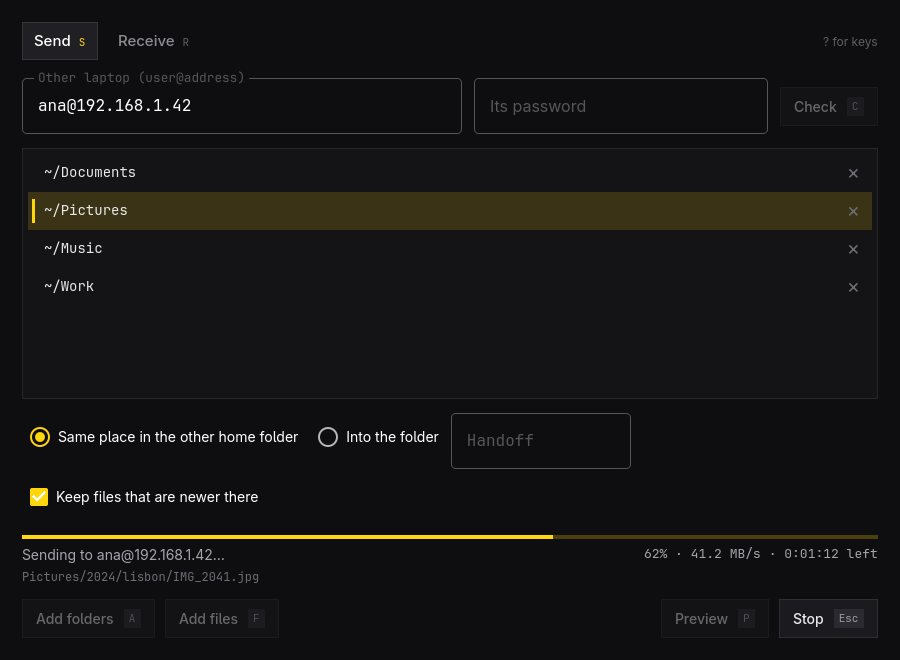

# Handoff



Send folders from one laptop to another over the local network, with rsync
over SSH. One window does both ends: **Send** on the laptop that has the
files, **Receive** on the one that gets them. Made for moving into a new
laptop, for [Omarchy](https://omarchy.org).

## How to use it

Install Handoff on both laptops and put them on the same Wi-Fi.

1. On the laptop that **receives**: open Handoff, press `R`, then `Space`.
   It asks for your password, turns the SSH server on, and lets only the
   local network through the firewall. It then shows an address such as
   `ana@192.168.1.42`.
2. On the laptop that **sends**: type that address and the other laptop's
   login password, press `A` to add folders, `P` to see what would be sent,
   and `Space` to send.
3. When you're done, press `Space` on the receiving laptop to close it again.

Each folder lands at the same place under the other home folder
(`~/Documents/tax` to `~/Documents/tax`), or all of them go into one folder
you name.

## What it does and doesn't do

- Nothing is ever deleted, on either laptop, and your originals are only read.
- Files that are newer on the receiving laptop are kept, unless you untick
  that.
- A transfer that stops (closed lid, lost Wi-Fi) carries on where it left
  off when you send again.
- The password is used for that session only and is never saved.
- Receiving starts the SSH server without enabling it at boot, and opens port
  22 only to the network the laptop is on. Stopping undoes both. If SSH was
  already running before, Handoff leaves it alone.
- A laptop seen for the first time is trusted and remembered; if its
  identity later changes, Handoff refuses to send.

## Keys

| Key | Does |
| --- | --- |
| `S` / `R` | Send or receive |
| `Space` | Send, or start and stop receiving |
| `Esc` | Stop the transfer, or leave a text field |
| `T` | Type the other laptop's address |
| `C` | Check the connection |
| `A` / `F` | Add folders or files |
| `↑` / `↓` | Move through the list |
| `Delete` | Take the selected one off the list |
| `Ctrl+Z` / `Ctrl+Shift+Z` | Undo and redo |
| `P` | Preview what would be sent |
| `Y` | Copy this laptop's address |
| `?` | Show every key |
| `Q` | Quit |

Letter keys type into a text field while one has the cursor; `Esc` leaves it.

## Command line

```sh
handoff send --to ana@192.168.1.42 --dry-run --json ~/Documents ~/Pictures
handoff send --to ana@192.168.1.42 --into Inbox ~/Downloads/film.mkv
handoff status --json
handoff skill install
```

`send` logs in with your SSH key, or with the password in `HANDOFF_PASSWORD`.
Every command exits 0 or 1 with the reason on stderr.

## Build

```sh
bin/build     # build/handoff
bin/test      # the tests, offscreen
bin/install   # build the package and install it, so it's in the launcher
```

Needs `qt6-base`, `qt6-declarative`, `qt6-wayland`, `rsync`, and `openssh`,
all part of Omarchy. The interface follows the Omarchy theme and language
(English and Spanish so far; add a catalog in `src/i18n/`).

## License

MIT. See [LICENSE](LICENSE).
